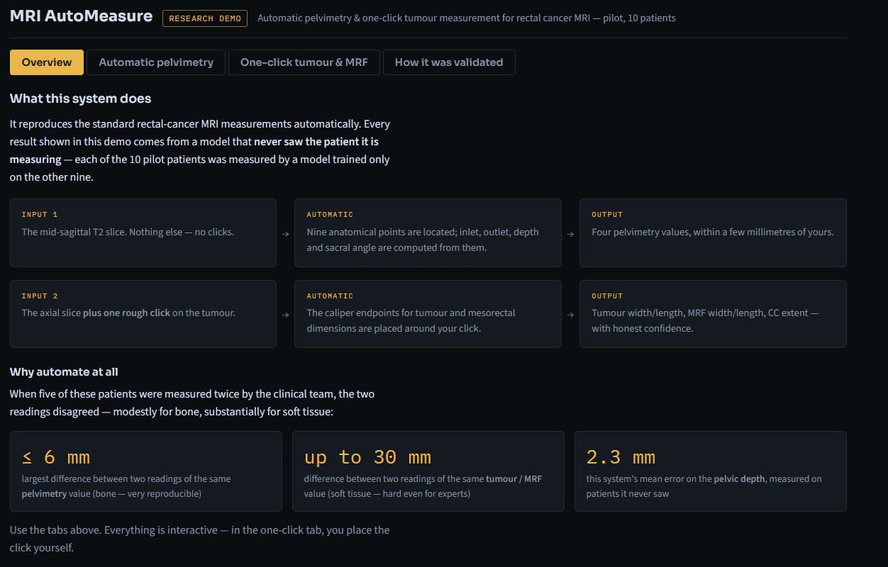
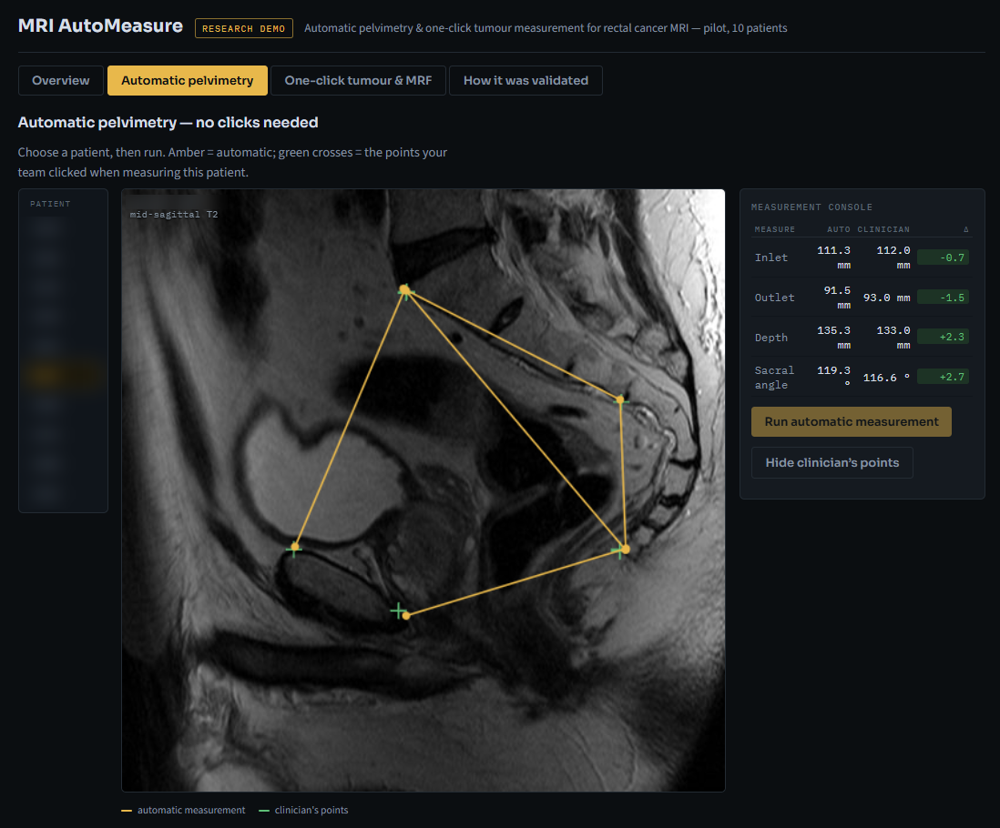
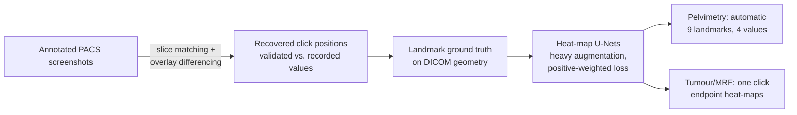

# MRI AutoMeasure

Automatic pelvimetry and one-click tumour/mesorectum measurement for rectal
cancer MRI — code, methods and pilot findings.

Before total mesorectal excision (TME), radiologists take a set of standard
measurements from the staging MRI: the bony pelvis (pelvimetry) and the
tumour and mesorectal package dimensions. These measurements predict how
difficult the operation will be — but taking them by hand is slow, and when
the same scans were measured twice by the same clinical team, the two
readings disagreed by up to 6 mm for bone and up to **30 mm for soft tissue**.
This project automates the measurements, so they become fast, consistent and
usable at cohort scale.

## What the demo shows

Screenshots from the interactive research demo (shared privately with the
clinical collaborators — see *Data availability*). Patient identifiers are
blurred.



*Overview tab — what the system takes in, what it does, and why: two readings
of the same value by the clinical team disagreed by up to 6 mm for bone and
up to 30 mm for soft tissue, against a 2.3 mm mean error for the automatic
pelvic depth on patients the model never saw.*



*Automatic pelvimetry tab — a held-out patient measured from the mid-sagittal
T2 slice with no clicks. Amber points and lines are the automatic
measurement; green crosses are the points the clinical team clicked. The
console compares automatic and clinician values for inlet, outlet, depth and
sacral angle (here within 0.7–2.7 mm / °).*

## Findings from the 10-patient pilot

Everything below is evaluated **leave-one-out**: every patient was measured
by a model that never saw that patient during training.

**Automatic pelvimetry** (input: the mid-sagittal T2 slice, no interaction):

| Measure | Mean abs. error | Median | Human re-reading differed by up to |
|---|---|---|---|
| Pelvic inlet | 2.3 mm | 1.4 mm | 6.3 mm |
| Pelvic depth | 3.4 mm | 3.0 mm | 4.3 mm |
| Pelvic outlet | 6.7 mm | 5.5 mm | 6.3 mm |
| Sacral angulation | 9.3° | 5.0° | 5.1° |

The inlet is within human re-measurement variability for every pilot patient.
The sacral angle has occasional large outliers — an endpoint slipping a few
millimetres *along* the smooth sacral cortex swings a short measuring ray by
many degrees; reformulations are planned for the cohort phase.

**One-click tumour / mesorectum measurement** (input: the axial or sagittal
slice plus one rough click near the tumour):

| Measure | Median abs. error | Mean | Human re-reading differed by up to |
|---|---|---|---|
| Tumour width | 7.2 mm | 10.4 mm | 13 mm |
| Tumour length | 9.7 mm | 10.8 mm | 5 mm |
| Mesorectal (MRF) width | 8.7 mm | 18.3 mm | 28 mm |
| Mesorectal (MRF) length | 8.1 mm | 16.0 mm | 30 mm |
| Tumour craniocaudal extent | 14.0 mm | 23.5 mm | 29 mm |

Medians sit inside the band where expert re-readings disagree; the means are
pulled up by a minority of clear failures (flat or ambiguous heat-maps).
Interpretation: the method works, eight training patients do not cover
soft-tissue variety — the quantified case for the ~300-patient cohort phase.

Two negative results are reported deliberately: inter-patient **2-D
registration** (multi-atlas landmark transfer) performed no better than
predicting the cohort median, and a network given a **wide field of view**
confidently measured the wrong structure. Both shaped the final design.

## How it works



1. **Ground-truth recovery** (`src/extract_ground_truth.py`): the clinicians'
   original caliper endpoints are recovered pixel-exactly from annotated
   viewer screenshots — content-matching each screenshot to its DICOM slice,
   subtracting the rendered slice to isolate the burned-in overlay, detecting
   the caliper lines, and labelling them against the recorded values
   (median agreement achieved: 0.34 mm). Anatomical-structure constraints
   (the pelvimetry triangle's shared corners, perpendicular crossing caliper
   pairs) plus visual QC of every case prevent coincidental-length false
   matches — a value check cannot validate a position.
2. **Automatic pelvimetry** (`src/landmark_net_loocv.py`): a ~1 M-parameter
   U-Net predicts one Gaussian heat-map per landmark; trained from 9 patients
   with heavy augmentation; peaks are selected jointly for consistency with
   the training patients' average pelvic configuration.
3. **One-click measurement** (`src/prompt_net_loocv.py`): the user's click
   centres a small fixed window (80–120 mm); a U-Net predicts heat-maps for
   the caliper endpoints inside it. Training simulates sloppy clicks (±8 mm)
   and each test patient is evaluated with five different clicks.

Two training details were decisive: a **positive-weighted loss** (plain MSE
collapses to "predict nothing" — target blobs are ~0.05 % of pixels) and
**tight click-centred windows** (wide views let the network measure the
wrong structure entirely).

## Data availability

**This repository contains no patient data.** No DICOM, no per-patient
measurements, no patient identifiers — the only imaging is the two
anonymised demo screenshots above (identifiers removed, shared under the
study's data-sharing agreement). The pilot imaging was
provided by the collaborating clinical centres for research and is not ours
to redistribute. The code expects your own data in the layout described in
`example_data/` (clinician values, optional QC overrides) with DICOM and
screenshot roots supplied via environment variables (`AUTOMEASURE_DICOM_ROOT`,
`AUTOMEASURE_VALUES`).

An **interactive demonstration** on the pilot patients (click the image,
see the model measure) exists and is shared privately with the clinical
collaborators; researchers interested in access or collaboration are welcome
to get in touch.

## Running it

```
pip install -r requirements.txt
set AUTOMEASURE_DICOM_ROOT=path\to\dicom      # Windows; export on Linux/macOS
python src/dicom_inventory.py <dicom_root> inventory.csv
python src/extract_ground_truth.py            # needs screenshots + values
python src/build_landmarks.py
python src/landmark_net_loocv.py --steps 1200 # GPU recommended
python src/prompt_net_loocv.py --task all
```

Stages are independent and resumable; each writes JSON results plus visual
QC overlays that are intended to be reviewed, not trusted blindly.

## Status and roadmap

Pilot phase complete (10 patients). Next: a ~300-patient two-centre cohort —
retraining, sacral-angle reformulation, automatic slice selection,
low-confidence flagging ("measure this one manually"), and the downstream
multivariable model predicting TME difficulty.

## Team

Shamsul Masum (University of Portsmouth) — data science, with clinical
collaborators in colorectal surgery and radiology (UK & Netherlands).

## License

MIT for the code in this repository (see `LICENSE`). Research use; not a
medical device. Nothing here constitutes clinical advice.
